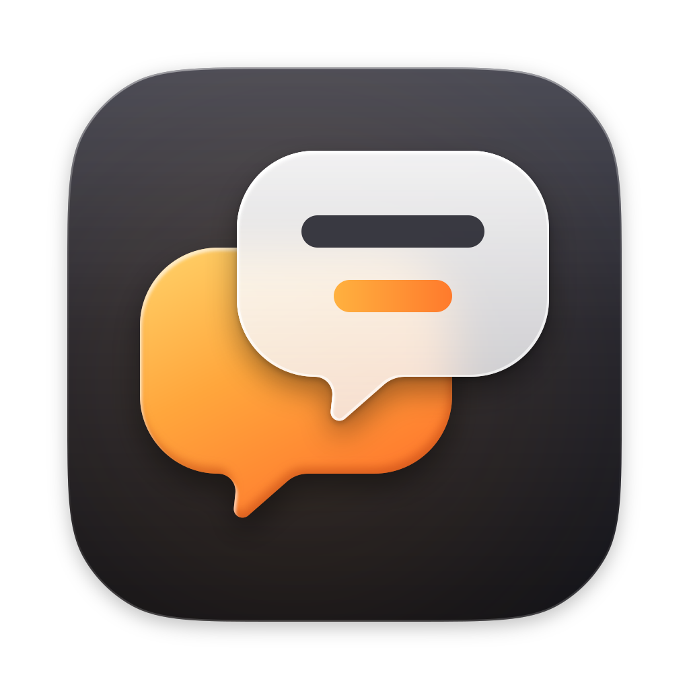

# SubtitleGen 앱 아이콘 후보 — 겹친 말풍선 (ember)

Task `task_b3260b23217c` / dispatch `ctx_e6235c528e2e`, 2026-10-09. 이 worktree의 `IconCandidate/` 안에서만 작업했습니다. 상위 저장소(`저장소 루트`)는 읽기만 했고, 커밋·푸시·게시·통합은 하지 않았습니다.

## 콘셉트

- **모양:** 같은 모양의 말풍선 두 개를 겹쳤습니다. 앰버색 말풍선은 원래 말(음성)이고, 그 위에 오른쪽 위로 비켜 놓은 반투명 유리 말풍선은 그 말의 자막입니다. 유리 말풍선 안의 두 줄 중 진한 줄은 전사문, 앰버색 줄은 번역문입니다.
- **꼬리:** 두 꼬리가 모두 왼쪽 아래를 향하게 해서, 겹쳐도 둘 다 보이게 했습니다. "같은 말의 두 번째 버전"으로 읽힙니다.
- **배경:** 그래파이트 타일(`#3B3B46` → `#23232B` → `#121217`)에 앰버(`#FFD36A` → `#FFA63C` → `#FF7B2E`)를 얹었습니다. 어두운 화면 위의 노란 자막이라는 익숙한 연상이 있고, Final Cut Pro·Logic Pro·Compressor·Motion 같은 Apple 프로 영상 앱의 어두운 타일과도 어울립니다.
- **피한 것:** 사용자가 싫어한 파란/청록 이퀄라이저 + 자막 막대, 글자, 작은 텍스트, 장식용 반짝이는 쓰지 않았습니다.
- **Apple Translate와의 차이:** Apple Translate(iOS 27)도 겹친 말풍선 두 개를 쓰지만 구성이 다릅니다. Translate는 청록 배경에 흰 말풍선과 어두운 말풍선을 두고, 꼬리가 서로 반대 방향이며, `A`/`文` 글자가 들어갑니다. 이 후보는 그래파이트 + 앰버 + 유리, 같은 방향 꼬리, 글자 없음입니다.
- **유리 표현:** 유리 말풍선 안에는 뒤의 앰버 말풍선과 타일을 흐리게(blur 34) 비춰서 굴절처럼 보이게 했습니다. 위쪽 안쪽 테두리에는 하이라이트를 넣었습니다. 겹치는 두 물체 중 앞의 것을 반투명 유리로 만드는 방식은 macOS 27의 iPhone 미러링 아이콘(진한 폰 뒤 + 반투명 유리 폰 앞)과 같은 계열이지만, 모양은 가져오지 않았습니다.

### 탐색한 시안 (`concepts.png`)

| 시안 | 결과 |
|---|---|
| **selected**: 앰버 왼쪽 아래, 유리 오른쪽 위, 수직에 가까운 짧은 꼬리 | 채택. 두 꼬리가 모두 보이고 32px에서도 두 말풍선으로 읽힙니다. |
| glass in front, lower-right: 앰버 왼쪽 위, 유리 오른쪽 아래 | 탈락. 앰버 꼬리가 유리 뒤에 가려져 앰버가 그냥 카드처럼 보입니다. |
| swept tail: 왼쪽으로 길게 뻗은 꼬리 | 탈락. 만화 말풍선 느낌이 강하고 작은 크기에서 꼬리가 가늘어집니다. |
| plum palette: 보라 타일 | 보류. 보기에는 좋지만 iMovie·Podcasts·Apple Configurator 같은 보라 계열 Apple 아이콘과 겹칩니다. |

첫 탐색에서는 크림색 유리 + 큰 깃발형 꼬리, 마주 보는 꼬리, 주황 타일도 그려 봤지만 범용 채팅 앱처럼 보여서 버렸습니다.

## Apple 참고 자료

모든 브라우저 조사는 ego-browser(task space 77)로 했습니다. 아이콘 이미지는 공식 iTunes Lookup API의 artwork URL로 받았습니다. 받은 Apple 아이콘은 비교용으로 scratchpad에만 두었고, `IconCandidate/`에는 넣지 않았습니다.

| 출처 | URL | 반영한 점 |
|---|---|---|
| HIG — App icons (2026-06-08 "Refined guidance for Liquid Glass") | https://developer.apple.com/design/human-interface-guidelines/app-icons | 겹친 채운 도형 + 투명도로 깊이감 만들기, 단순한 배경, 텍스트 지양, 얇은 선·뾰족한 모서리 지양, 마스크 없는 정사각 레이어, Icon Composer 레이어 구성 |
| macOS 27 Golden Gate 소개 | https://www.apple.com/os/macos/ (https://www.apple.com/macos/ 에서 리디렉션) | 현행 macOS가 27이며 Liquid Glass가 개선됐다는 점 |
| iPhone Mirroring 지원 문서 | https://support.apple.com/en-us/120421 | macOS 27 Dock 이미지 https://cdsassets.apple.com/live/7WUAS350/images/macos/golden-gate/macos-27-golden-gate-dock-iphone-mirroring.png 의 갱신된 아이콘. 진한 물체 뒤 + 반투명 유리 물체 앞, 비켜 놓은 겹침 |
| iPhone Mirroring 로컬 앱 (macOS 27.2, 26B5091g) | `/System/Applications/iPhone Mirroring.app/Contents/Resources/AppIcon.icns` | 16/32px 표현의 타일 크기 측정, 시스템 렌더링 비교 기준 |
| Final Cut Pro 12.4 (2026-09-29) | https://apps.apple.com/us/app/final-cut-pro/id424389933?mt=12 | 어두운 프로 앱 타일, 타일 마스크·그림자 측정 기준 |
| Logic Pro 12.4 | https://apps.apple.com/us/app/logic-pro/id634148309?mt=12 | 어두운 타일, 마스크 측정 |
| Xcode 27.0 | https://apps.apple.com/us/app/xcode/id497799835?mt=12 | 마스크 측정 |
| iMovie 10.4.5 | https://apps.apple.com/us/app/imovie/id408981434?mt=12 | 보라 계열 회피, 마스크 측정 |
| Compressor 5.4 / Motion 6.4 | https://apps.apple.com/us/app/compressor/id424390742?mt=12 · https://apps.apple.com/us/app/motion/id434290957?mt=12 | 영상 앱 계열의 재질·깊이 |
| Pixelmator Pro 3.8 / GarageBand / MainStage | https://apps.apple.com/us/app/pixelmator-pro/id1289583905?mt=12 · https://apps.apple.com/us/app/garageband/id682658836?mt=12 · https://apps.apple.com/us/app/mainstage/id634159523?mt=12 | 밝은·주황 타일 사례 |
| Apple Configurator 2.21 (2026-10-05) | https://apps.apple.com/us/app/apple-configurator/id1037126344?mt=12 | 반투명 유리 카드를 겹쳐 쌓은 전경 |
| Translate (iOS, 2026-09-14) | https://apps.apple.com/us/app/translate/id1514844618 | 겹친 말풍선 선례. 베끼지 않도록 차이를 둔 기준 |
| TestFlight / Apple Developer | https://apps.apple.com/us/app/testflight/id899247664 · https://apps.apple.com/us/app/apple-developer/id640199958 | 유리 질감 전경 |
| iTunes Lookup API | `https://itunes.apple.com/lookup?entity=macSoftware&country=us&id=…` | 위 앱들의 버전·출시일·512px artwork |

로컬 macOS 27.2의 Messages, FaceTime, Notes, Freeform, Preview, Podcasts `AppIcon.icns`도 크기별 타일 측정에 썼습니다.

## 사양

- **캔버스:** 1024×1024, 타일 824×824 at (100,100).
- **모서리:** 연속 곡률(squircle) 모서리, radius 187, smoothing 0.66. 이 값은 Final Cut Pro·Xcode·iMovie 512px 알파 마스크에 맞춘 것입니다. 512px에서 다른 픽셀은 81개로, 테두리 안티앨리어싱 수준입니다.
- **그림자:** dy 8, blur 14, 검정 25%. 타일 아래·옆의 알파 감쇠가 Final Cut Pro 512px와 ±3 이내로 맞습니다.
- **16·32px 마스터:** Apple macOS 27 아이콘의 작은 표현과 같은 규격으로 따로 만들었습니다.
  - 32px(16@2x): 타일 802, 그림자 없음.
  - 16px: 타일 778, 그림자 없음.
- **픽셀 격자 정렬:** 자막 줄이 정수 픽셀에 오도록 했습니다.
  - full 마스터: 16단위 격자라 64·128px에서 정수 픽셀입니다. 선 두께 48, 간격 48.
  - 32 마스터: 2px 선 두 줄, 1px 간격.
  - 16 마스터: 1px 선 한 줄.
- **말풍선 꼬리:** 몸통의 네 모서리는 원호이고, 꼬리 양쪽 접합부는 오목 필렛입니다(안쪽 46, 바깥쪽 26). 끝은 반경 13으로 둥글렸습니다. 바깥쪽 필렛이 왼쪽 아래 모서리 호가 시작하는 지점에서 정확히 끝나서, 윤곽에 꺾임이나 평평한 턱이 없습니다.
- **필터 색 공간:** 모든 SVG 필터에 `color-interpolation-filters="sRGB"`를 지정했습니다. librsvg 기본값인 linearRGB에서는 어두운 그라데이션에 5~6 단계씩 띠(banding)가 생겼습니다.

## 생성 파일

모든 경로는 `<Orca 작업 공간>/icon-opus-xhigh/` 기준입니다.

| 파일 | 내용 | SHA-256 |
|---|---|---|
| `IconCandidate/AppIcon-1024.png` | 1024×1024 RGBA. `.icns`에서 다시 꺼낸 `icon_512x512@2x`입니다. | `cef03e32d470fce9f5de2d94e5e0d7f8e52f61a35e077f7aaaeebc62ce17096a` |
| `IconCandidate/AppIcon.icns` | 552,012 bytes. 청크: ic04 16, ic11 32, ic12 64, ic07 128, ic13·ic08 256, ic14·ic09 512, ic10 1024, info | `9ed171bd863496e6e14b3910572ea219b9665d18837c32a1902090fc23a8347f` |
| `IconCandidate/source/AppIcon.svg` | 64px 이상용 편집 가능 마스터 | `b65c1d9b7368acd29041ffed2323b59a7d6c269d10d03699ed7087c22a67161d` |
| `IconCandidate/source/AppIcon-32.svg` | 32px(16@2x)용 마스터 | `290b6d9cf6fb2f8a6dfb3018491a91a88399078bc0353cad03cceafa6784272d` |
| `IconCandidate/source/AppIcon-16.svg` | 16px용 마스터 | `ed59490d545e20c5c39f557044c881e59b3c0a3057304dbeed075a81cd5fe6f2` |
| `IconCandidate/source/icon-composer-layers/0-background.svg` … `3-captions.svg` | Icon Composer용 평면 레이어 4장: 배경, 앰버 말풍선, 유리 말풍선, 자막 줄. 마스크와 효과는 넣지 않았습니다. | 아래 참고 |
| `IconCandidate/contact-sheet.png` | 밝은/어두운 배경에서 16/32/64/128/256px, 16·32px 4배 확대. `.icns`를 다시 풀어 나온 PNG로 만들었습니다. | `772531811288324ed350404786b170eef1fdc8b23484b30fd810ace3c2df57dd` |
| `IconCandidate/system-render-check.png` | macOS 27.2 `NSWorkspace`가 실제로 그린 512/128/64/32/16px, 밝은/어두운 배경 | `5cba93d9deed5fff8efe5731f971785a09bf9544b5036264a84e300902de7fa4` |
| `IconCandidate/concepts.png` | 시안 4종 비교 | `991548b20b1b44a3dc5365a531d54ca5367fc83745c87bb13dafbe703433d8e6` |
| `IconCandidate/generate_icon.py` | 위 파일을 모두 다시 만드는 스크립트 | `af70a3bcddc57c2246cdec9ae41dc96e74cae9726ac7a237e843708029c06785` |
| `IconCandidate/report.md` | 이 문서 | — |

레이어 SHA-256:

- `0-background.svg`: `51c2ef87…a675`
- `1-amber-bubble.svg`: `6ea7615f…0852`
- `2-glass-bubble.svg`: `9485bac5…b140`
- `3-captions.svg`: `5d2f0f7f…bdaa`

재생성 명령: `python3 IconCandidate/generate_icon.py`. 시스템 렌더링 점검까지 하려면 `--system-check`를 붙입니다. 필요한 도구는 rsvg-convert 2.62.1, iconutil, Pillow 12.2.0이고, `--system-check`에는 swift도 필요합니다.

## 렌더링 검증

1. **직접 확인한 이미지:**
   - `AppIcon-1024.png` 원본
   - 2048px 확대 크롭: 꼬리 접합부, 유리 테두리, 그림자
   - `contact-sheet.png`, `system-render-check.png`, `concepts.png`
   - Icon Composer 레이어 합성 미리보기
2. **`.icns` 구조:** 생성 스크립트가 `.icns`를 `iconutil -c iconset`으로 다시 풀어, 9개 표현이 모두 기대한 크기의 RGBA인지 확인합니다. 하나라도 다르면 실패로 끝납니다. 결과는 16, 32, 64, 128, 256(×2), 512(×2), 1024입니다. `file` 명령은 `Mac OS X icon`이라고 보고합니다.
3. **그라데이션 띠:** 타일 세로 픽셀값이 1~3씩 부드럽게 변합니다. 수정 전에는 5~6씩 튀었습니다.
4. **작은 크기 가독성 (`contact-sheet.png`):**
   - 32px: 앰버/흰 두 말풍선, 유리 말풍선의 꼬리, 2px 자막 두 줄(진한 줄 + 앰버 줄)이 모두 또렷합니다.
   - 16px: 두 말풍선 실루엣과 1px 자막 한 줄이 보입니다.
   - 어두운 배경에서는 그래파이트 타일 테두리가 약하지만, 두 말풍선이 형태를 유지합니다.
5. **macOS 27.2의 실제 렌더링 (`--system-check`):** 임시 .app에 `.icns`를 넣고 `NSWorkspace.icon(forFile:)`로 그렸습니다.
   - 512/128/64/32px는 회색 레거시 틀 없이 그대로 그려집니다. 시스템이 자체 유리 테두리만 더합니다.
   - 16px은 밝은 회색 둥근 사각 틀 안에 들어갑니다. 같은 조건에서 Apple의 iPhone Mirroring `AppIcon.icns`도 16px에서 똑같이 틀에 들어가므로, `.icns` 경로에서는 피할 수 없는 시스템 동작입니다.
6. **32@1x(ic05)를 뺀 이유:** `icon_32x32.png`(ic05)가 있으면, 타일 크기(790/802/812/824)나 그림자 유무와 관계없이 macOS 27.2가 32px을 회색 틀에 넣었습니다. ic05를 빼면 32px을 `icon_16x16@2x`로 그리고 틀이 생기지 않습니다. Xcode 26+가 만든 Apple 앱의 대체 `.icns`(Xcode, Final Cut Pro, Pixelmator Pro, Calculator, Chess, Terminal)도 16, 16@2x, 128, 128@2x만 들어 있고 ic05가 없습니다. 그래서 이 `.icns`에는 16~1024 모든 픽셀 크기가 들어 있지만, 표준 10개 표현 중 ic05 하나는 빠져 있습니다.

## 남은 것

- **16px 회색 틀과 Liquid Glass 변형:** macOS 26+에서 16px 틀 문제를 없애고 dark/clear/tinted 변형까지 지원하려면, `source/icon-composer-layers/`를 Icon Composer로 `.icon`으로 만들어 asset catalog에 넣어야 합니다. 이번 범위(통합 금지) 밖이라 하지 않았습니다.
- **앱 통합:** 앱에 적용하려면 상위 저장소의 `SubtitleGen/Resources/AppIcon.icns`를 바꾸고, 필요하면 `scripts/generate-app-icon.sh`를 이 스크립트로 대체해야 합니다. 둘 다 하지 않았습니다.
- **어두운 Dock에서의 대비:** 이 판단은 사용자 확인이 필요합니다.

## 모델 / effort

- **모델:** Claude Opus 5.5 (`claude-opus-5-5`). 세션 시스템 정보에 표시된 값입니다.
- **effort:** 세션 안에서는 확인할 수 없습니다. worktree 이름 `icon-opus-xhigh`로 보면 xhigh로 요청된 것 같지만, 검증하지 못했습니다.
- **ego-browser:** task space 77을 썼습니다. 마무리 시점에는 이미 목록에서 사라져 있어서 `finish()`가 "task space not found"를 반환했습니다. 남겨 둔 페이지는 없습니다.
