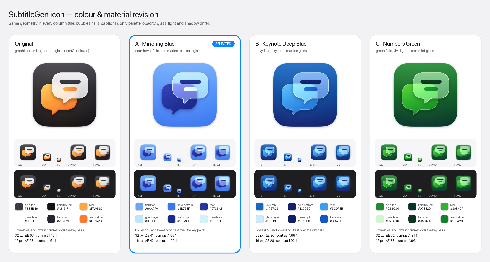

# SubtitleGen 아이콘 — 색·재질 수정 (모양 유지)

Task `task_2eb39a2624a6` / dispatch `ctx_96b5369a4b0e`, 2026-10-09. 이 worktree의 `IconColourRevision/` 안에서만 작업했습니다. `IconCandidate/`는 읽기만 했습니다(아래 "원본 보존" 참고). 상위 프로젝트 코드·리소스·패키지는 건드리지 않았고, 커밋도 하지 않았습니다.



## 요약

- **선택안: A · Mirroring Blue.** 콘셉트는 iPhone Mirroring 아이콘과 같습니다. 콘플라워 블루 배경 위에 깊은 울트라마린 뒷말풍선을 두고, 그 앞에 옅은 유리 말풍선을 겹쳤습니다. 유리가 뒷말풍선을 덮는 부분은 라벤더색으로 보입니다.
- **비교안:** B · Keynote Deep Blue, C · Numbers Green.
- **모양:** 세 변형 모두 원본과 byte 단위로 같은 모양입니다. 대상은 타일, 두 말풍선, 꼬리, 자막 pill, 16/32/full 마스터별 레이아웃입니다.
- **바꾼 것:** 팔레트, 불투명도, 유리 재질, 빛(림·광택), 그림자뿐입니다.
- **원본에서 지적된 점 해소:** 그래파이트 + 앰버의 고대비와 불투명한 흰 유리 블록을 없앴습니다. 원본에 있던 두꺼운 하단 베벨(`rimShade`)도 뺐습니다.

## 정적 fallback과 네이티브 Liquid Glass의 구분

| 종류 | 파일 | 성격 |
|---|---|---|
| **정적 fallback** | `AppIcon.icns`, `AppIcon-1024.png`, `source/AppIcon*.svg`, `variants/*/AppIcon*` | 유리·림·그림자를 SVG 필터로 그려 넣은 고정 비트맵. 시스템 조명 반응이나 dark/clear/tinted 모드가 없음 |
| **네이티브 Icon Composer 원재료** | `source/icon-composer-layers/*.svg` (선택안 A) | 효과 없는 평면 레이어. 동적 Liquid Glass는 root가 이 레이어로 만드는 `.icon`에서만 나옴 |

- 레이어는 원본과 같은 1024 좌표계입니다. 타일 영역은 100..924입니다.
- 이 worker는 `.icon`을 만들거나 검증하지 않았습니다. 코디네이터 메시지에 따르면, root가 이 레이어로 `.icon`을 만들어 컴파일하고 NSWorkspace 렌더링까지 확인했습니다.

## 참고 색 측정

Dock 스크린샷의 PNG에는 디스플레이 ICC 프로필("Display")이 붙어 있습니다. 그래서 원시 픽셀값이 sRGB보다 라벤더 쪽으로 치우쳐 보입니다. 색 기준은 로컬 앱 아이콘을 `NSWorkspace.icon(forFile:)`로 512px로 그려 측정했습니다(scratchpad 전용, 결과물에는 넣지 않음). 측정 대상은 macOS 27.2의 `/System/Applications/iPhone Mirroring.app`, `/Applications/Keynote Creator Studio.app`, `/Applications/Numbers Creator Studio.app`입니다. Simulator는 이 Mac에 설치돼 있지 않아서, 스크린샷 확대본에서 "흰 바탕 위 반투명 파랑·보라 겹침"이라는 구성만 참고했습니다.

| 앱 | 배경 | 뒤 물체 | 앞 물체 / 겹침 |
|---|---|---|---|
| iPhone Mirroring | `#61A1F9` → `#4E90FD` → `#3B7DFF` | `#20319F` | 배경 위 `#99DAFB`, 뒤 물체 위 `#6979E1`, 림 `#A8E9FF` |
| Keynote | `#0060AA` → `#003F8F` → `#0F1F75` | — | 하늘색 `#54B9F3`·`#67CBFF`, 하이라이트 `#B5DEF7` |
| Numbers | `#006500` → `#004812` → `#002C2B` | — | 막대 `#00AA00`, 바닥선 `#59CE07` |

iPhone Mirroring의 앞 유리는 단순한 알파 합성으로 설명되지 않았습니다. 뒤에 있는 색에 각 채널마다 약 +68(0.27)이 더해진 값과 맞았습니다(plus-lighter 방식). 예를 들어 `#20319F`는 `#6979E1`이 됩니다. 이 방식을 SVG `feComponentTransfer`의 `intercept`로 재현했습니다.

## 팔레트

### A · Mirroring Blue (선택)

| 요소 | 값 |
|---|---|
| 배경 그라데이션 | `#6AA7FA` → `#4F8EFB` (55%) → `#3B76EF` |
| 뒷말풍선 | `#3747C2` → `#2736A3` → `#1C2789`. 위쪽 얇은 림 30%, 2.5px 링 30% |
| 앞 유리 | 뒤 장면(배경 + 뒷말풍선 + 그 그림자)을 blur 8로 흐린 뒤 R/G/B에 +0.25/+0.26/+0.26을 더함. 위에 `#E6F7FF` 베일 10%(full), 22%(16·32px)와 흰 광택 20% → 0 |
| 결과 색 (32px 측정) | 배경 위 유리 `#BAE8FF`, 뒷말풍선 위 유리 `#8597EF` |
| 림 | 유리 테두리 `#DDF5FF` 2.5px 링 85%와 위쪽 안쪽 하이라이트(blur 1.5, offset 1.5/3). 타일 테두리는 흰색 55% → 16% → 8% → 22% |
| 그림자 | 말풍선 그림자를 검정 대신 `#0A1B6E`로 바꿈(full 30%, 16·32px 42%). 앞말풍선 그림자는 그 75%. 타일 그림자는 원본과 같음(dy 8, blur 14, 검정 25%) |
| 자막 줄 | 전사문 `#192A8E` 95%, 번역문 `#FFFFFF` → `#D3F1FF` |

### B · Keynote Deep Blue

- 배경: `#1767C3` → `#0F4597` → `#13206C`
- 뒷말풍선: 하늘색 `#62C4FB` → `#3C9FEE` → `#2478D9`
- 유리: +0.20/+0.21/+0.22, 베일 `#E4F5FF` 18%/38%
- 자막: 전사문 `#0F1E68`, 번역문 `#1F74E4` → `#1557C6`
- 그림자: `#040D45`

### C · Numbers Green

- 배경: `#228C34` → `#0F5B27` → `#07332D`
- 뒷말풍선: `#62D83C` → `#30B42F` → `#169226`
- 유리: +0.20/+0.22/+0.20, 베일 `#EEFFE6` 18%/38%
- 자막: 전사문 `#0A3420`, 번역문 `#1EA132` → `#108428`
- 그림자: `#02190F`

### 원본 대비 재질 변경

- `rimShade`(뒷말풍선 아래쪽의 어두운 두꺼운 테두리)를 제거했습니다.
- `rimLight`의 offset을 3/5에서 1.5/3으로 줄여 얇게 만들었고, 색은 흰색 대신 팔레트의 림 색을 씁니다.
- 앞 유리:
  - 원본: 흰색 93%→78%의 거의 불투명한 채움, blur 34
  - 이번: 밝기 가산 + 낮은 베일, blur 8. 뒷말풍선의 윤곽이 유리 너머로 보입니다.
- 뒷말풍선에도 얇은 밝은 링을 넣어, 두 말풍선 모두 Liquid Glass식 가는 림을 갖게 했습니다.

## 변형 선택

생성기는 16·32px 마스터를 실제 크기로 렌더링합니다. 그다음 영역마다 픽셀 하나를 표본으로 잡고 핵심 색 쌍의 CIE76 ΔE와 WCAG 대비를 계산합니다. 표본 픽셀은 둥근 모서리, 자막, 뒷말풍선 그림자를 피해 영역 안쪽에 오도록 `LAYOUTS`에서 직접 계산했습니다. 결과는 `validation.json`에 있습니다.

| 변형 | 16px 가장 약한 쌍 ΔE | 32px 가장 약한 쌍 ΔE | 가장 낮은 대비 (32 / 16px) |
|---|---|---|---|
| 원본 (graphite + amber) | 62.9 | 62.6 | 1.43 / 1.51 |
| **A · Mirroring Blue** | **42.0** | **40.6** | 1.88 / 1.90 |
| B · Keynote Deep Blue | 28.3 | 26.4 | 1.88 / 1.92 |
| C · Numbers Green | 32.6 | 32.5 | 1.91 / 1.96 |

A의 세부 값:

| 크기 | 색 쌍 | 대비 | ΔE |
|---|---|---|---|
| 32px | 뒷말풍선 / 배경 | 3.73 | 49.5 |
| 32px | 유리 / 배경 | 1.88 | 40.6 |
| 32px | 뒷말풍선 위 유리 / 뒷말풍선 | 3.35 | 41.2 |
| 32px | 전사문 / 유리 | 8.22 | 83.7 |
| 32px | 번역문 / 뒷말풍선 위 유리 | 2.49 | 55.3 |
| 16px | 전사문 / 뒷말풍선 위 유리 | 3.93 | 42.5 |

선택 이유:

1. **레퍼런스와의 일치:** A는 사용자가 지목한 iPhone Mirroring의 구성과 측정값에 가장 가깝습니다. 배경은 중간 밝기 파랑, 뒤는 더 깊은 파랑, 앞은 옅은 파랑 유리이고, 겹친 부분은 라벤더입니다. 뒷말풍선 쪽은 Keynote 하단의 인디고와 같은 계열입니다.
2. **작은 크기의 구분:** 16px과 32px 모두에서 가장 약한 쌍의 ΔE가 세 변형 중 가장 높습니다. 생성기의 순위 출력은 `mirroring, numbers, keynote`입니다.
3. **B의 약점:** 남색 배경 위의 유리가 중간 파랑이 됩니다. 그래서 뒷말풍선/배경 ΔE가 26~28로, 16px에서 말풍선 윤곽이 흐려집니다.
4. **C의 약점:** 녹색은 Dock에서 Numbers·Messages·FaceTime과 겹칩니다. 뒷말풍선과 배경의 대비도 1.91:1로 낮습니다.

**원본보다 나빠진 점:** 원본은 그래파이트·앰버·흰색의 밝기 차가 커서 ΔE 기준 구분이 더 컸습니다(약 63). A의 가장 약한 쌍은 "유리 / 배경"입니다. 밝기 대비는 1.88~1.90:1로 낮고, 주로 색상 차이(ΔE 40 이상)로 구분됩니다. 같은 색 계열 안에서 겹침을 표현하는 iPhone Mirroring도 같은 방식입니다. 32·16px에서 두 말풍선과 자막 줄이 읽히는 것은 `contact-sheet.png`와 `system-render-check.png`에서 눈으로 확인했습니다.

## 모양이 바뀌지 않았다는 근거

생성기를 실행할 때마다 다음을 검사하고, 하나라도 다르면 `sys.exit`로 멈춥니다(`check_geometry`, `check_alpha`).

1. **SVG 도형 비교:**
   - 마스터마다 `<path id="tile|back|front" d=…>`와 자막 `<rect …>`에서 색·불투명도 속성만 빼고 문자열을 비교합니다.
   - 비교 대상은 세 가지입니다: 원본 생성기(`IconCandidate/generate_icon.py`를 import해 `build_svg(master, "ember")`로 생성한 SVG), 원본 SVG 파일, 세 변형.
   - 결과:
     - `AppIcon.svg`: 5 도형(타일, 뒷말풍선, 앞말풍선, 자막 2) 모두 동일
     - `AppIcon-32.svg`: 5 도형 모두 동일
     - `AppIcon-16.svg`: 4 도형(자막 1) 모두 동일
2. **Icon Composer 레이어 비교:** 뒷말풍선·유리 말풍선·자막 path와 rect가 원본 `IconCandidate/source/icon-composer-layers/`와 같습니다(세 변형 모두).
3. **`.icns` 알파 채널 비교:** 원본 `IconCandidate/AppIcon.icns`와 새 `.icns`를 풀어 9개 표현을 비교했습니다.
   - 완전 불투명(255)이거나 완전 투명(0)인 픽셀은 모두 같습니다.
   - 차이는 원본에서도 반투명이던 가장자리 픽셀에서만 납니다. 원인은 타일 가장자리 위에 그리는 림·광택·글로의 불투명도를 바꾼 것입니다.

   | 크기 | 달라진 가장자리 픽셀 | 최대 차이 |
   |---|---|---|
   | 16px | 52개 중 12개 | 2/255 |
   | 32px | 100개 중 51개 | 3/255 |
   | 64px | 422개 중 121개 | 4/255 |
   | 128px | 1,581개 중 308개 | 6/255 |
   | 1024px | 96,559개 중 1,727개 | 7/255 |

4. **청크 구성:** 원본과 같습니다. `ic04 ic11 ic12 ic07 ic13 ic08 ic14 ic09 ic10 info`이고, ic05는 원본과 같은 이유로 넣지 않았습니다(macOS 27.2에서 ic05가 있으면 32px이 회색 틀에 들어감).

## 렌더링 검증

1. **`.icns` 왕복 검사:** `iconutil -c iconset`으로 다시 풀어 9개 표현이 모두 기대한 크기의 RGBA인지 확인했습니다: 16, 32, 64, 128, 256×2, 512×2, 1024. `file` 명령은 `Mac OS X icon, 583567 bytes`라고 보고합니다.
2. **NSWorkspace 실제 렌더링 (`--system-check`):** 임시 `.app`에 `.icns`를 넣고 macOS 27.2의 `NSWorkspace.icon(forFile:)`로 그렸습니다. 결과는 `system-render-check.png`입니다.
   - 512/128/64/32px: `drawn as is`. 시스템이 자체 테두리만 더합니다.
   - 16px: `boxed in grey container`. 원본, 그리고 같은 조건의 Apple iPhone Mirroring `.icns`와 같은 동작입니다(원본 report 참고).
3. **직접 확인한 이미지:**
   - `AppIcon-1024.png`와 680×600 확대 크롭: 유리 림, 라벤더 겹침, 그림자
   - `contact-sheet.png`: 밝은/어두운 배경
   - `system-render-check.png`, `colour-comparison.png`
   - Icon Composer 레이어 평면 합성: 유리 불투명도 100%와 55%
   - `variants/mirroring/AppIcon-1024.png`와 최상위 `AppIcon-1024.png`(`.icns`에서 다시 꺼낸 것)는 픽셀이 같습니다.
4. **원본 보존:**
   - `IconCandidate/`의 14개 파일 SHA-256이 작업 전후로 같습니다.
   - 원본 생성기는 `sys.dont_write_bytecode = True`로 import해서 `__pycache__`가 생기지 않았습니다(확인함).

## Icon Composer용 레이어

`source/icon-composer-layers/` (선택안 A)와 `variants/<name>/icon-composer-layers/`:

| 파일 | 내용 |
|---|---|
| `0-background.svg` | 1024×1024 전면(full bleed) 사각형. 세로 그라데이션 `#6AA7FA` → `#4F8EFB` → `#3B76EF`. 타일 마스크 없음 |
| `1-rear-bubble.svg` | 뒷말풍선, 단색 `#2736A3` |
| `2-glass-bubble.svg` | 앞말풍선, 단색 `#BFE6FF` |
| `3-captions.svg` | 전사문 `#192A8E`, 번역문 `#D3F1FF` 단색 pill |

- 네 파일 모두 `filter`, `opacity`, `mask`, `clip`이 없습니다(grep 결과 0).
- 전경 레이어는 그라데이션도 없는 단색입니다. 유리 질감, 블러, 림, 그림자, 마스크는 Icon Composer가 더하도록 비워 두었습니다.
- **주의:** 번역문 줄 `#D3F1FF`는 유리 레이어가 반투명이어야 보입니다.
  - 유리 레이어 불투명도 100%: 번역문/유리 대비 1.11:1로 거의 보이지 않습니다.
  - 55%: 뒷말풍선 위 유리가 `#7B97D6`이 되어 대비 2.46:1입니다.
  - Icon Composer에서 유리 레이어의 opacity나 translucency를 그 정도로 두는 것을 전제로 했습니다. 실제 값은 root가 Icon Composer에서 정해야 합니다.

`AppIcon.icns`와 PNG는 유리 효과를 그려 넣은 정적 비트맵입니다. 시스템의 동적 Liquid Glass(조명 반응, dark/clear/tinted 모드)가 아닙니다. 그런 동작은 위 레이어로 만든 `.icon`에서만 나옵니다.

## 생성 파일

모든 경로는 `<Orca 작업 공간>/icon-opus-xhigh/IconColourRevision/` 기준입니다.

| 파일 | 내용 | SHA-256 |
|---|---|---|
| `generate_icon.py` | 재현용 생성기 (아래 명령) | `0e7355d42a37376d838d1ca4ee73b0799af8d1b6ecc7656261f0713a00851586` |
| `AppIcon.icns` | 선택안 A, 9개 표현, ic05 없음, 583,567 bytes | `e19a271b8d5e1beaac87bed2c16c46fb2dc0b5f51c61a64c4bbd51723da375b7` |
| `AppIcon-1024.png` | `.icns`에서 다시 꺼낸 `icon_512x512@2x` | `bdfcf575253d65505bc199bbaaadc3d5e6b1d79a72ba230bca3f80704ac3f91e` |
| `source/AppIcon.svg` | full 마스터 (64px 이상) | `3add6502ee078b007a20d969c012cf2582b559ec5bfb5502e666e2a94052f1b0` |
| `source/AppIcon-32.svg` | 32px(16@2x) 마스터 | `47682bf0db2285f6171b2285dd5287f874818c15e70c412f982974a9902663db` |
| `source/AppIcon-16.svg` | 16px 마스터 | `376814061bd6dc84b3773766cbb302c081f3301301d5c2a33fce76b133e104c4` |
| `source/icon-composer-layers/0-background.svg` | 배경 | `e26436bce9ad0fb541dc7f9b85ef9146984e8fc8ecca2c6f3ed9aa3d557f0ed2` |
| `source/icon-composer-layers/1-rear-bubble.svg` | 뒷말풍선 | `62587799bfc83e5e910377942d7f667e017dd526ae96336c0c73c84bde35c597` |
| `source/icon-composer-layers/2-glass-bubble.svg` | 유리 말풍선 | `8f4d25e0a136f54345e559919ecaedee07dd38bcd15ade8cddf759d34312dd69` |
| `source/icon-composer-layers/3-captions.svg` | 자막 줄 | `2d851b53cb03439b4537faacb88128e5a883dab44b44e1f25e28db345899a9fd` |
| `contact-sheet.png` | 밝은/어두운 배경, 16/32/64/128/256px와 16·32px 4배 확대 | `7c93e6e0b8362a6bfa8de032cc6e4040136b5538cea800a74dc90e7558184e3f` |
| `system-render-check.png` | NSWorkspace 렌더링, 밝은/어두운 배경 | `eefef0a67cae4ebb699071738a1ecc59d09e555f09725e32a5c307623cc9b4d3` |
| `colour-comparison.png` | 원본 + A/B/C. 256px, 실제 크기 64/32/16(밝은·어두운 배경), 확대, 색 칩과 hex, 작은 크기 점수. 3160×1692 (2x) | `644bafcec9e97246def881e924a8b1ad28a880ca43ed87f8d171b3f9adacc959` |
| `validation.json` | 모양 검사, 알파 검사, 가독성 수치, 순위 | `4f98d5ddd93b8eaa2f8e25e6ce899f186b01479b5051b11efe0ab5b1d5be9acf` |
| `variants/{mirroring,keynote,numbers}/` | 변형별 SVG 마스터 3개, `AppIcon-1024.png`, `icon-composer-layers/` 4장 | — |
| `report.md` | 이 문서 | — |

## 재현

worktree 루트에서 실행합니다:

```bash
python3 IconColourRevision/generate_icon.py                 # 모양 검사 → 변형 3종 → 선택안 .icns/PNG/시트 → 알파 검사
python3 IconColourRevision/generate_icon.py --system-check  # + NSWorkspace 렌더링 검사
```

- 필요한 도구: rsvg-convert 2.62.1, iconutil, Pillow 12.2.0. `--system-check`에는 swift가 추가로 필요합니다.
- 원본 `IconCandidate/`가 있어야 모양·알파 검사가 돌아갑니다.
- 선택안을 바꾸려면 `SELECTED`를 `keynote`나 `numbers`로 바꿉니다.
- 색만 조정하려면 `PALETTES`를 고칩니다. 기하 구간(`squircle`, `bubble`, `pill`, `captions`, `TAILS`, `LAYOUTS`, `TILE_SIZE`)은 원본에서 그대로 복사한 것이고, 검사가 그 동일성을 강제합니다.

## 작업 중 사건

작업 도중 데이터 볼륨 여유 공간이 약 117MiB까지 떨어져, 셸 명령이 ENOSPC로 실패했습니다. 코디네이터에게 에스컬레이션했고, root가 상위 프로젝트에서 `swift package clean`(재생성 가능한 빌드 산출물)을 실행해 약 561MiB를 확보한 뒤 재개했습니다. 이 worker는 아무것도 삭제하지 않았습니다. `IconColourRevision/` 전체 크기는 2.3MB입니다.

## 모델

Claude Opus 5.5 (`claude-opus-5-5`). 하위 작업자나 서브에이전트에는 위임하지 않았습니다. 브라우저도 쓰지 않았습니다.
