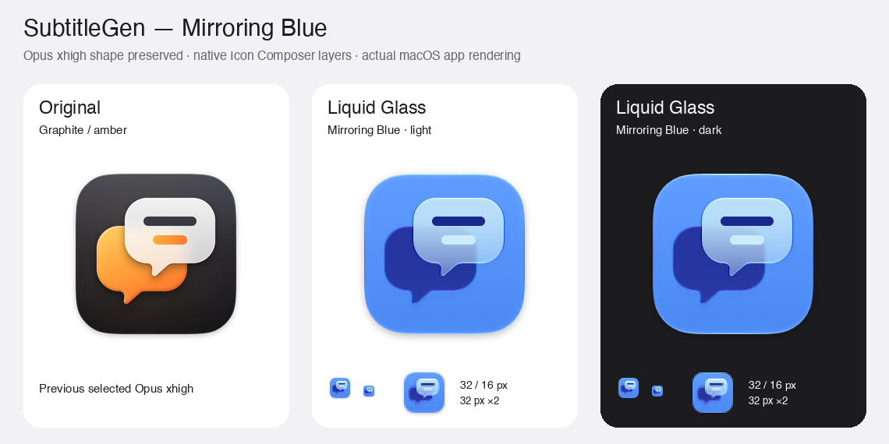

# Opus xhigh 색상·Liquid Glass 수정

선택한 형태는 그대로 두고 **Mirroring Blue**를 앱과 서명 DMG에 반영했습니다. 첨부한 Dock과 로컬 iPhone Mirroring·Keynote·Numbers 아이콘을 참고했습니다. 최초 graphite/amber 안과 새 색상 세 가지는 [색상 비교](IconColourRevision/colour-comparison.png)에서 볼 수 있습니다.



[상세 디자인 보고서](IconColourRevision/report.md)와 [원본 검증 기록](IconColourRevision/validation.json)을 보관합니다. 타일·말풍선·꼬리·자막의 SVG 도형이 원본과 동일함을 검사했고, 작은 크기의 가독성과 ICNS 9개 크기의 왕복 변환을 확인했습니다. 이전 제작 후보와 이전 배포용 아이콘도 보존했습니다.

실제 배포 아이콘은 `SubtitleGen/Resources/IconSource/AppIcon.icon`입니다. 깨끗한 SVG 세 장을 각각 그룹으로 나누어 시스템이 반사·굴절·블러·투명도를 계산합니다. 밝은·어두운·색조 모드의 `IconImageStack`이 들어간 `Assets.car`를 Xcode 27의 actool로 컴파일하고 `CFBundleIconName=AppIcon`을 연결합니다. 정적 ICNS도 함께 포함합니다. 앱의 최소 배포 대상은 macOS 14.0이며 이번 실제 렌더링 확인은 macOS 27.2에서 진행했습니다.

기존 ICNS의 824px 타일 영역을 Icon Composer의 마스킹 전 1024px 캔버스로 옮겼습니다. `build-native-icon.py`에 좌표 변환과 초기 재질 설정을 기록했습니다. 그룹 배열은 가장 앞에 있는 자막 → 앞 유리 → 뒤 말풍선 순서입니다. 원본 도형의 상대 위치·비율은 유지합니다.

재현:

```bash
python3 design/icon-colour-revision/IconColourRevision/generate_icon.py
bash scripts/generate-app-icon.sh
bash scripts/compile-app-icon.sh /path/to/SubtitleGen.app
NOTARIZE=0 bash scripts/build-dmg.sh
```

원본·시안 재생성에는 rsvg-convert, iconutil, Pillow가 필요합니다. 배포 빌드는 저장된 ICNS와 네이티브 `.icon`을 사용하므로 Pillow가 필요하지 않습니다. `.icon`은 Icon Composer에서 직접 편집할 수 있습니다.

`worker-launch.json`에 Orca 실행 설정(Claude Opus, xhigh), Task/Dispatch ID와 워크트리를 보관했습니다. 워커는 성공 완료 후 release로 닫았고 워크트리와 파일은 유지합니다.

Apple 공식 참고: [App icons](https://developer.apple.com/design/human-interface-guidelines/app-icons), [Creating your app icon using Icon Composer](https://developer.apple.com/documentation/xcode/creating-your-app-icon-using-icon-composer).
